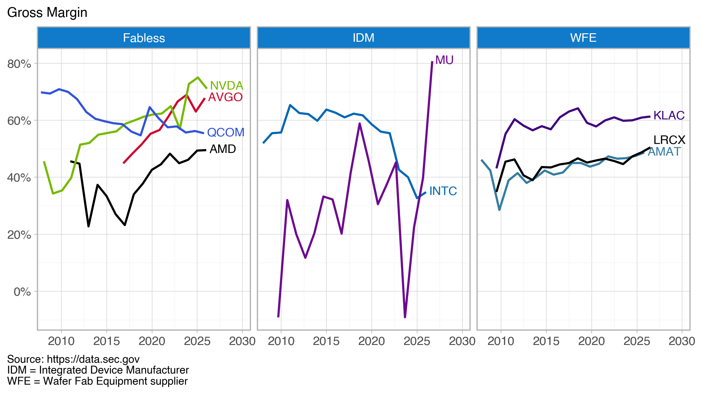

# Gross Margin Tracking for U.S. Semiconductor Companies

Companion code for the blog post "Tracking Gross Margins" at [rayjameshoobler.com](https://rayjameshoobler.com).

The notebook pulls annual financial data from the SEC's EDGAR system, calculates gross margin for nine U.S. semiconductor companies (fabless, IDM, and wafer fab equipment suppliers), and plots the trends with Plotnine.



## Files

- `gross_margin_trends-example.ipynb`: the notebook
- `requirements.txt`: Python packages used
- `gross_margin_us_semis.png`: the resulting chart

## Quick start

Tested with Python 3.13.

```
pip install -r requirements.txt
jupyter lab
```

Before running, edit `HEADERS` in the first code cell with your name and email. The SEC requires a descriptive User-Agent on every request. The notebook pauses between calls to stay under the SEC's limit of 10 requests per second.

## Adapting it

- **Different companies:** edit the `tickers` list and the `sectors` and `brand_colors` tables.
- **Updated data:** rerun the notebook; each run pulls the latest filings.

## Data

Source: [SEC EDGAR XBRL company facts](https://data.sec.gov). Gross margin is gross profit divided by revenue from 10-K filings. When a company doesn't report a gross profit tag, it is calculated as revenue minus cost.
